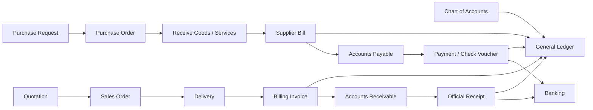
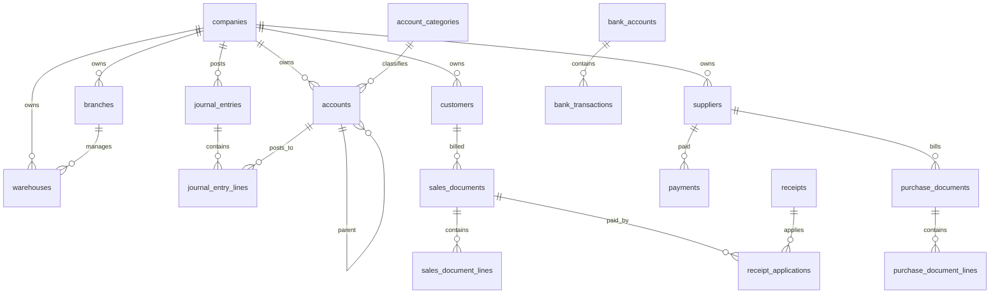

# SeaJet ERP Architecture

## Product Scope

SeaJet ERP is a Laravel 5.7, MySQL, Bootstrap 5 SME ERP starter inspired by QuickBooks, SAP Business One, NetSuite, and Odoo. The first implementation focuses on a professional shell, accounting-first data model, printable documents, reporting foundations, and module workspaces ready for Ajax CRUD.

## Module Structure

| Module | Main Tables | Core Workflows |
| --- | --- | --- |
| Dashboard | activity_logs, sales_documents, purchase_documents, bank_accounts | KPI cards, charts, recent transactions, aging |
| Chart of Accounts | account_categories, accounts, fiscal_years | COA setup, opening balances, fiscal year controls |
| General Ledger | journal_entries, journal_entry_lines, activity_logs | manual journal, auto posting, reversing, recurring, trial balance |
| Accounts Receivable | customers, sales_documents, sales_document_lines, receipts, receipt_applications | quote to cash, SOA, invoice, collections |
| Billing Invoice | sales_documents, sales_document_lines, attachments, comments | invoice creation, VAT, PDF, email, QR verification |
| Statement of Account | customers, sales_documents, receipts, document_templates | SOA, SOA A, aging buckets, customer ledger, outstanding balances |
| Collections | receipts, receipt_applications, bank_transactions, document_templates | official receipts, acknowledgement receipts, SOA A collections, partial and multi-invoice payment |
| Accounts Payable | suppliers, purchase_documents, purchase_document_lines, payments | PR to PO, receiving, supplier bill, payment, voucher |
| Banking | bank_accounts, bank_transactions | cashbook, deposits, withdrawals, transfers, FX conversion, reconciliation, daily cash position |
| Multi-Currency & FX | currency_rates, fx_gain_loss_entries, bank_transactions, sales_documents, purchase_documents | USD/PHP conversion, realized gain/loss, unrealized revaluation |
| Tax | tax_codes, sales_documents, purchase_documents, activity_logs | 12% VAT, zero-rated export services, VAT-exempt, EWT, CWT, sales/purchase summaries, audit trail |
| Users & Access | users, approval_requests, login_logs, activity_logs | roles, permissions, approvals, audit trail |

## Menu Hierarchy

- Dashboard
- Accounting
- Accounts Receivable
- Billing Invoice
- Collections
- Accounts Payable
- Purchasing
- Banking
- Multi-Currency & FX
- Financial Reports
- Tax Management
- Users & Access

## ERP Process Flow



## ERD



## Recommended Laravel Folders

```text
app/
  Http/Controllers/Erp/
    DashboardController.php
    ModuleController.php
    Accounting/
    Receivables/
    Payables/
    Banking/
    Reports/
  Http/Middleware/RoleAccess.php
  Models/
  Services/
    Accounting/PostingService.php
    Tax/TaxCalculator.php
    Documents/NumberingService.php
  Policies/
  Observers/
database/
  migrations/
  seeds/
resources/views/erp/
  layout.blade.php
  dashboard.blade.php
  modules/
  print/
routes/
  web.php
```

## Recommended Controllers

| Controller | Responsibility |
| --- | --- |
| `ChartOfAccountsController` | COA tree, account setup, fiscal year opening balances |
| `JournalEntryController` | manual, recurring, reversing, posting lock, audit |
| `CustomerController` | master data, credit limit, terms |
| `QuotationController` | estimates and conversion to sales orders |
| `SalesOrderController` | order approval and delivery readiness |
| `BillingInvoiceController` | billing, VAT, PDF, email, QR |
| `StatementOfAccountController` | SOA generation, aging, customer ledger |
| `ReceiptController` | collections, OR, allocations |
| `SupplierController` | supplier master data |
| `PurchaseOrderController` | purchasing workflow and approvals |
| `SupplierBillController` | AP recording and tax input |
| `PaymentController` | pay bills, vouchers, checks |
| `BankReconciliationController` | deposits, withdrawals, reconciliation |
| `FinancialReportController` | balance sheet, P&L, cash flow, tax reports |
| `UserAccessController` | roles, permissions, logs |

## Suggested Routes

```php
Route::prefix('erp')->middleware(['auth'])->group(function () {
    Route::resource('accounts', 'Erp\\Accounting\\ChartOfAccountsController');
    Route::resource('journals', 'Erp\\Accounting\\JournalEntryController');
    Route::resource('customers', 'Erp\\Receivables\\CustomerController');
    Route::resource('invoices', 'Erp\\Receivables\\BillingInvoiceController');
    Route::resource('receipts', 'Erp\\Receivables\\ReceiptController');
    Route::resource('suppliers', 'Erp\\Payables\\SupplierController');
    Route::resource('purchase-orders', 'Erp\\Payables\\PurchaseOrderController');
    Route::resource('supplier-bills', 'Erp\\Payables\\SupplierBillController');
    Route::resource('bank-accounts', 'Erp\\Banking\\BankAccountController');
    Route::get('reports/profit-loss', 'Erp\\Reports\\FinancialReportController@profitLoss');
});
```

## UI Wireframe Ideas

- Dashboard: KPI grid, revenue/expense/profit chart, AR aging donut, recent transactions, approval queue, quick actions.
- Module workspace: header actions, searchable DataTable, right-side controls summary, export buttons, audit status.
- Billing invoice: two-column header, customer and billing details, item grid, VAT computation, QR code, signature area.
- SOA: date range filters, outstanding balance card, invoice listing, aging bucket cards.
- SOA A: plain printable form without pre-printed alignment, USD/PHP handling, customer and shipment references.
- Debit Note: pre-printed layout with customer ID, job/shipment ID, VAT classification, class, and A/R Trade-Debit Note account.
- Collections: pre-printed Official Receipt and Acknowledgement Receipt layouts, plus SOA A collection without a pre-printed form.
- Accounting forms: debit/credit grid with live balance check and posting status badge.
- Banking: multi-bank cashbook, deposit and withdrawal entry, FX tracking table, reconciliation worksheet, and daily cash position report.
- Multi-Currency & FX: USD/PHP rate table, conversion worksheet, realized and unrealized FX gains/losses, and shipment-linked revaluation register.
- Tax: VAT summary cards, withholding list, tax calculator, summary list of sales and purchases, and tax audit trail.

## Customer Billing Rules

Required fields for customer billing and collections:

| Field | Use |
| --- | --- |
| Customer ID | External/customer-facing customer code used on forms and reports |
| Job/Shipment ID | Shipment or job reference printed on BI, SOA A, Debit Note, OR, and AR |
| Invoice No | Billing Invoice, SOA A, and Debit Note document number |
| VAT Classification | Allowed values: `12%`, `zero-rated`, `exempt` |
| Class | Allowed values: `MANILA`, `PAMPANGA`, `CEBU` |
| Credit Terms | Standard terms: `30`, `60`, `90` days |
| Currency | Supported AR currencies: `PHP`, `USD` |

Customer master profile fields:

| Field | Use |
| --- | --- |
| Credit Limit | Maximum approved receivable exposure by customer |
| Payment Terms | Standard customer terms: 30, 60, or 90 days |
| Tax Classification | Customer default VAT classification for billing |
| Currency | Default billing currency, PHP or USD |

Vendor master profile fields:

| Field | Use |
| --- | --- |
| Payment Terms | Standard supplier terms: COD, 30, 60, or 90 days |
| Tax Classification | Supplier default VAT classification |
| Preferred Payment Method | Cheque, bank transfer, or online transfer |
| Withholding Tax Setup | Default EWT setup used by AP bill entry |

Customer billing document templates:

| Document | Template | Pre-printed |
| --- | --- | --- |
| Billing Invoice | `BI-PREPRINT` | Yes |
| Statement of Account | `SOA-PREPRINT` | Yes |
| Statement of Account A | `SOAA-PLAIN` | No |
| Debit Note | `DN-PREPRINT` | Yes |
| Official Receipt | `OR-PREPRINT` | Yes |
| Acknowledgement Receipt | `AR-PREPRINT` | Yes |

AR account mapping by currency:

| Code | Account Name |
| --- | --- |
| `AR_TRADE_BI` | A/Trade-Billing Invoice |
| `AR_REIMBURSABLE` | A/R Reimbursable Charges |
| `AR_TRADE_SOAA` | A/R Trade-SOA A |
| `AR_TRADE_DN` | A/R Trade-Debit Note |

## Accounting Traceability Rule

- Every journal entry must contain a `shipment_job_id`.
- Every invoice must contain a `job_shipment_id`.
- Every supplier bill, purchase expense, or expense document must contain a `shipment_job_id`.
- Financial statements should allow drilldown from statement line to GL entry to Shipment Job ID.
- Manual journal entry forms must reject save/post actions when Shipment Job ID is empty.

## Accounts Payable Rules

- Vendor bill entry must capture Supplier, Bill No, Bill Date, Due Date, Shipment Job ID, client/customer tagging, currency, exchange rate, gross amount, withholding tax, net payable, and expense account.
- AP must support PHP and USD at bill and payment level.
- Shipment-linked expenses must be tagged to a client/customer when reimbursable or job-related.
- Payment processing supports bank, cheque, and online transfer.
- Payments should pass through approval before release.
- Check vouchers and printed checks must include supplier, bill no, shipment job ID, currency, amount, WHT, and approval trail.
- AP aging buckets should show Current, 30, 60, and 90+ by supplier, bill, shipment job, and currency.

## Banking Rules

- Bank accounts must support multiple banks, account numbers, branch names, currencies, book balances, and bank statement balances.
- Cashbook entries must classify movement as deposit, withdrawal, fund transfer, or FX conversion.
- Bank transactions should retain reference number, Shipment Job ID when tied to a shipment, document currency, exchange rate, foreign amount, and PHP base amount.
- Deposit and withdrawal tracking should update the cashbook and remain available for reconciliation matching.
- Bank reconciliation compares book balance, bank balance, outstanding deposits, outstanding withdrawals, and adjusted balance.
- FX conversion tracking must store the exchange rate used at transaction time for audit and financial reporting.
- Daily cash position reports should summarize available cash by bank account and currency.

## Multi-Currency & FX Rules

- Base currency is PHP; foreign currency support currently includes USD.
- Store document rate, settlement rate, foreign amount, PHP base amount, and gain/loss amount.
- Realized FX gain/loss is computed when a receivable, payable, bank item, or cash transaction is settled at a rate different from the document rate.
- Unrealized FX gain/loss is computed during revaluation of open USD balances using the current reporting rate.
- FX entries tied to invoices, bills, collections, or expenses should retain Shipment Job ID.
- Realized and unrealized FX postings should flow to GL through a journal entry with audit trail.

## Tax Management Rules

- VAT classification must support `12% VAT`, `Zero-rated export services`, and `VAT-exempt`.
- 12% VAT transactions compute output VAT for sales and input VAT for purchases.
- Zero-rated export services and VAT-exempt documents compute VAT at 0%, but remain separately listed for tax reporting.
- Expanded withholding tax is tracked mainly on supplier bills and payment processing.
- Creditable withholding tax is tracked on customer sales or collections where the customer withholds tax.
- Summary lists of sales and purchases must include document date, document number, party, Shipment Job ID, VAT class, currency, base amount, VAT, and withholding amount.
- Tax changes and computations should be written to `activity_logs` with user, reference document, old values, new values, and timestamp.

## Accounting Architecture Best Practices

- Keep all financial impact in the general ledger through a posting service. AR, AP, banking, and tax modules should generate balanced journal entries.
- Use immutable posted documents. Corrections should be credit memos, debit memos, reversals, or adjustment entries.
- Store document currency, exchange rate, base amount, and foreign amount for multi-currency reporting.
- Use period locks to prevent posting to closed fiscal periods.
- Separate document status from posting status. A document can be approved but not yet posted.
- Record every create, update, delete, approval, posting, void, and login in `activity_logs`.
- Use branch and company scoping on every business table.
- Use decimal fields for money and quantity. Never use floats for accounting.
- Generate document numbers through a centralized numbering service by company, branch, module, fiscal year, and document type.
- Run server-side DataTables for large ledgers and reports.
- Use queued jobs for PDF generation, email sending, large Excel exports, and report snapshots.
- Add database indexes on document dates, document numbers, customer, supplier, status, company, branch, and posting period fields.
